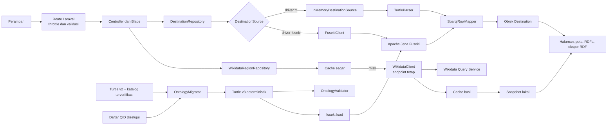

# Arsitektur WayFinder

## Gambaran umum

WayFinder adalah aplikasi Laravel 13/PHP 8.4 dengan antarmuka Blade. Data pariwisata utama berada di graph RDF/Turtle; aplikasi dapat membaca graph melalui Apache Jena Fuseki atau langsung dari file Turtle v3. Chatbot Gemini adalah fitur terpisah dan opsional.



## Data destinasi

`DestinationRepository` memakai antarmuka `DestinationSource`, sehingga pencarian, detail, statistik, dan data peta menggunakan kontrak yang sama pada kedua driver.

- `ONTOLOGY_DRIVER=fuseki` (bawaan) memakai `SparqlDestinationSource` dan `FusekiClient`.
- `ONTOLOGY_DRIVER=ttl` memakai `InMemoryDestinationSource`, yang mem-parse `ONTOLOGY_V3_TTL_PATH` dan memetakan graph melalui `OntologyGraphMapper`.
- Kegagalan Fuseki dilaporkan sebagai respons aman; aplikasi tidak diam-diam mengganti ke file lokal karena hal itu dapat menyajikan graph yang berbeda.
- Kueri pencarian, urutan relevansi, dan paginasi dibangun di `DestinationQueryBuilder`; rincian bidang dan bobot ada di [fitur-pencarian](fitur-pencarian.md).

Sumber migrasi v2 dibaca dari `ONTOLOGY_V2_TTL_PATH` dan tidak ditimpa. `OntologyMigrator` menghasilkan graph v3 yang deterministik dari sumber tersebut, katalog wilayah, dan daftar QID destinasi yang disetujui. `OntologyValidator` memeriksa skema, jumlah/ID destinasi, sentinel, relasi, dan `owl:sameAs`. `fuseki:load` memvalidasi serta mencadangkan graph sebelum pemuatan dan membandingkan jumlah data sesudahnya.

## Pengayaan Wikidata

`WikidataQueryBuilder` hanya menyusun query konstan dengan QID terverifikasi dalam `VALUES`. `WikidataClient` memakai endpoint tetap dan memvalidasi hasil. `WikidataRegionRepository` menggabungkan data wilayah dan destinasi pada satu permintaan live per halaman detail, lalu menerapkan urutan cache segar → live → cache basi → snapshot → `null`. Jalur web tidak melakukan retry; timeout live bawaan 3 detik. Kegagalan eksternal tidak boleh menggagalkan render halaman.

Katalog QID wilayah, persetujuan destinasi, snapshot, lisensi, dan batas cakupannya dijelaskan di [sumber eksternal](sumber-eksternal.md) dan [kandidat tautan](kandidat-tautan-wikidata.md). Asal data bukan teks yang ditampilkan pada UI.

## Penyajian dan endpoint

- Route publik untuk beranda, daftar/detail destinasi, dan peta dibatasi 60 permintaan per menit per identitas rate limiter Laravel; chatbot tetap memakai batas 10 per menit.
- Hasil pencarian interaktif menggunakan endpoint JSON `destinations.live`, `destinations.suggest`, dan `map.live`.
- Halaman detail menambahkan metadata RDFa/Open Graph dan menyediakan ekspor Turtle, RDF/XML, serta JSON-LD jika driver mendukung format tersebut.
- Driver Turtle lokal hanya mengekspor Turtle. Format ekspor lain merespons HTTP 501; kegagalan Fuseki merespons HTTP 503 dengan pesan publik generik.
- Header keamanan global dipasang melalui middleware `SecurityHeaders`.

## Verifikasi terkait

```bash
php artisan ontology:validate
php artisan ontology:doctor
php artisan test --compact
vendor/bin/pint --dirty --format agent
npm run build
```

Untuk detail prosedur integrasi dan hasil pemeriksaan, lihat [bukti SPARQL](bukti-sparql.md), [setup Fuseki](SETUP-FUSEKI.md), dan [smoke test](SMOKE-TEST.md).
