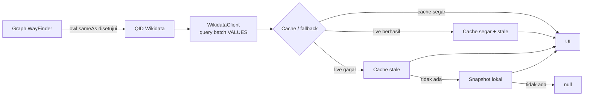

# Sumber dan pengayaan eksternal

Dokumen ini mencatat sumber eksternal yang digunakan oleh WayFinder dan cara data tersebut dipadukan dengan graph pariwisata Sumatera Utara.

## Lisensi dan atribusi

- **Data terstruktur Wikidata** tersedia di bawah dedikasi domain publik CC0. Label, alias, properti, dan sitelink yang disalin ke snapshot tidak memerlukan atribusi CC BY; atribusi sumber tetap dicatat di sini untuk keterlacakan penelitian.
- **Gambar Wikimedia Commons** memiliki lisensi yang ditetapkan per berkas. Sebelum penggunaan ulang, periksa halaman berkas yang ditautkan dari foto untuk memastikan lisensi, pencipta, dan syarat atribusi yang berlaku. WayFinder tidak menganggap semua gambar Commons memiliki lisensi yang sama.
- Berkas detail menyimpan nama berkas Commons dan URL halaman berkas. Tampilan foto menautkan ke halaman berkas agar informasi lisensi dapat diperiksa.

## Pemetaan

| Data Wikidata | Penggunaan di WayFinder |
| --- | --- |
| `owl:sameAs` ke QID wilayah/destinasi | Identitas eksternal yang disetujui; QID destinasi harus tercantum di `database/ontology/external/wikidata-destinasi-tautan.json`. IRI entitas RDF kanonik yang dipakai adalah `http://www.wikidata.org/entity/Q…`. |
| Label dan alias berbahasa Indonesia/Inggris | Nama pembanding dan teks alternatif di snapshot; tidak mengubah graph lokal. |
| Sitelink Wikipedia Indonesia | Tautan artikel ensiklopedia pada kartu info. |
| Sitelink Wikivoyage | Tautan panduan perjalanan; pilih edisi Indonesia terlebih dahulu, lalu Inggris, dan simpan bahasa yang dipilih. |
| `P18` | Berkas gambar Commons; nama berkas, URL gambar aman, dan URL halaman berkas disimpan terpisah. |
| `P1435` | Status penetapan warisan/cagar budaya; paling banyak tiga label, bahasa Indonesia lebih diutamakan lalu Inggris. |
| `P2044` | Ketinggian; hanya nilai yang dapat dinormalisasi atau diverifikasi dalam meter ditampilkan. |
| `P571` | Tahun berdiri; disimpan hanya pada presisi tahun atau lebih rinci. Presisi abad/dekade tidak ditampilkan. |
| `P47` (wilayah) | Hanya pemeriksaan silang atas relasi perbatasan yang sudah ada; bukan sumber pengganti graph lokal. |

Sitelink menunjuk halaman proyek Wikimedia yang terkait dengan entitas. Sitelink bukan salinan isi artikel dan WayFinder hanya menampilkan tautan keluar.

## Alur arsitektur

Jalur halaman menggunakan urutan **cache segar → live → cache stale → snapshot → null**. Satu permintaan SPARQL live menggabungkan QID wilayah terverifikasi dan destinasi yang disetujui, sehingga pembukaan halaman detail tidak mengirim satu permintaan per properti atau per destinasi. Properti bernilai banyak di jalur refresh CLI dipisahkan ke kueri batch `VALUES` agar tidak terjadi ledakan kartesian.

Jalur halaman menggunakan timeout pendek (`live_timeout`, bawaan 3 detik), tanpa retry. Kunci cache berumur singkat mencegah permintaan ganda bersamaan; bila kunci gagal diperoleh, halaman memakai data cadangan. Penanda `failure_cooldown` hanya menyimpan status kegagalan dan tidak menyimpan isi respons. Respons yang gagal atau tidak valid tidak dimasukkan ke cache data. Kegagalan layanan/cache dicatat sebagai peringatan dan tidak menggagalkan halaman.

## Cakupan snapshot yang diverifikasi

Angka di bawah dihitung langsung dari snapshot setelah refresh live pada **15 November 2026**; angka ini bukan perkiraan cakupan seluruh Wikidata:

- **Wilayah:** 30 wilayah terverifikasi; koordinat 30/30, gambar 12/30, Wikipedia Indonesia 30/30, Wikivoyage Indonesia 4/30 dan Inggris 1/30, label Indonesia 30/30, label Inggris 30/30, alias minimal satu bahasa 30/30, populasi 30/30, luas 30/30, dan situs resmi 24/30. Pasangan batas P47 yang diperiksa silang berjumlah 51.
- **Destinasi:** 1 QID disetujui dari 304 destinasi lokal; gambar Commons 1/1, artikel Wikipedia Indonesia 0/1, Wikivoyage 0/1, status warisan 0/1, ketinggian terverifikasi dalam meter 0/1, dan tahun berdiri pada presisi yang diterima 0/1. [Snapshot detail destinasi](../database/ontology/external/wikidata-destinasi-detail.json) hanya menanyakan QID yang disetujui.
- Angka wilayah dan destinasi dapat dihitung ulang dari [snapshot detail wilayah](../database/ontology/external/wikidata-wilayah-detail.json) dan snapshot destinasi di atas. Refresh berikutnya dapat mengubah cakupan.
- Daftar kandidat dan alasan keputusan terdapat di [kandidat-tautan-wikidata.md](./kandidat-tautan-wikidata.md). Hasil penemuan adalah kandidat, bukan bukti identitas otomatis selain entri yang lolos aturan persetujuan.

Snapshot adalah cuplikan pada waktu pengambilan dan dapat berubah di refresh berikutnya. Nilai yang tidak ada tetap `null` atau daftar kosong; WayFinder tidak mengisi data berdasarkan tebakan.

## Alasan desain dan keterbatasan

- Tautan destinasi memakai persetujuan eksplisit agar kemiripan nama atau kedekatan koordinat saja tidak menyatakan identitas yang keliru.
- Query live dibatasi ke QID dari katalog wilayah dan berkas persetujuan. Input HTTP pengguna tidak dirangkai ke query Wikidata.
- Cache/snapshot menjaga halaman tetap tersedia saat Wikidata tidak dapat dijangkau, tetapi dapat ketinggalan perubahan dan tidak menjamin semua properti tersedia.
- Kandidat, koordinat, label, klasifikasi, status warisan, dan nilai kuantitatif Wikidata dapat salah atau belum lengkap; pengguna tetap perlu memeriksa sumber aslinya.
- **Asal data eksternal tidak ditampilkan sebagai teks pada UI.** Paper dan dokumentasi ini menjelaskan sumber, lisensi, dan keterbatasannya; foto tetap menyediakan tautan halaman berkas untuk pemeriksaan lisensi.

## Rujukan

- Wikidata, [Copyright](https://www.wikidata.org/wiki/Wikidata:Copyright) — lisensi CC0 untuk data terstruktur.
- Wikimedia Commons, [Licensing](https://commons.wikimedia.org/wiki/Commons:Licensing) — lisensi dan atribusi per berkas.
- Wikibase, [RDF Dump Format](https://www.mediawiki.org/wiki/Wikibase/Indexing/RDF_Dump_Format) dan [contoh RDF entitas Q42](https://www.wikidata.org/wiki/Special:EntityData/Q42.ttl) — pemetaan RDF dan prefix `wd:` ke `http://www.wikidata.org/entity/`; contoh entity data secara langsung memakai `wd:Q42`.
- Wikidata, [Property:P18](https://www.wikidata.org/wiki/Property:P18), [P47](https://www.wikidata.org/wiki/Property:P47), [P1435](https://www.wikidata.org/wiki/Property:P1435), [P2044](https://www.wikidata.org/wiki/Property:P2044), dan [P571](https://www.wikidata.org/wiki/Property:P571).
